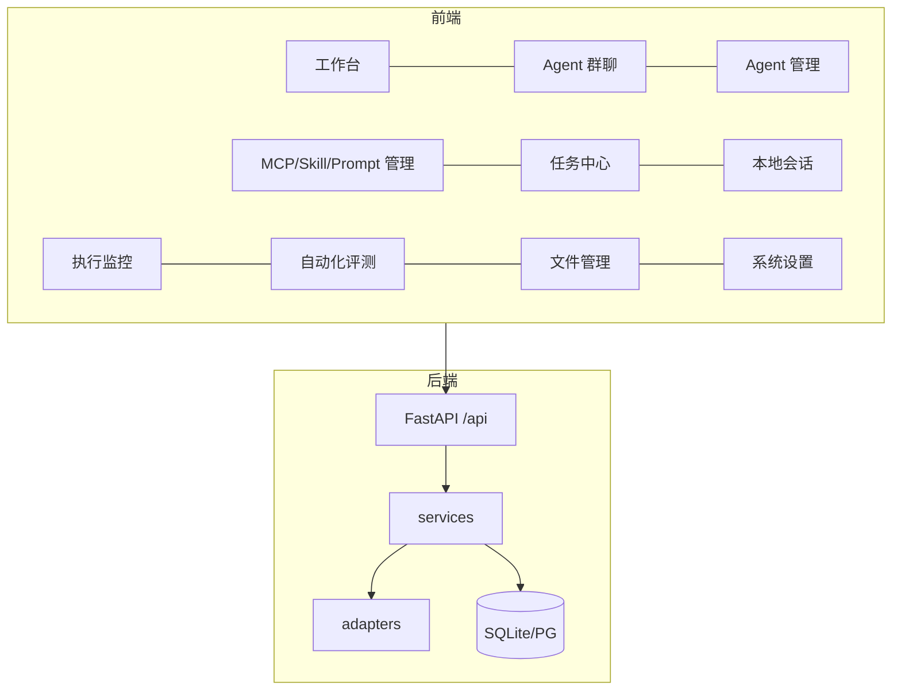

# 06 · 功能地图与页面导览

面向“接手代码的人”：每个页面在做什么、对应哪些接口、读写哪些表。前端页面在 `frontend/src/pages/`，后端路由在 `backend/app/api/`。

## 总览

## 页面

### 工作台 `Dashboard.vue` → `/`

- 统计卡片（Agent 数、任务状态、成功率、平均耗时、token、成本）
- 每日执行堆叠柱图、各 Agent 执行次数条形图（ECharts）
- **任务关系图 / 思维导图**（`components/TaskGraphPanel.vue`，两张独立卡片）
- 最近任务列表

接口：`GET /api/system/dashboard/summary`、`GET /api/graph/task/{id}`、`GET /api/graph/task/{id}/mindmap`
数据：`tasks`、`agent_runs`、`trace_events`（读）

### Agent 群聊 `Chat.vue` → `/chat`

- 左：会话列表（新建/重命名/归档）、成员数、活跃标记
- 中：消息流；Agent 消息 **Markdown 渲染**；执行中显示「生成中」气泡（`agent_delta` 流式）；`@提及`；超长折叠
- 右：协作任务、步骤时间线、审批、交接、成员角色、暂停/恢复/终止

接口：`/api/conversations*`、`/api/tasks`、`/api/events`、`WS /api/ws`
数据：`conversations`、`conversation_members`、`messages`、`tasks`、`task_steps`、`handoffs`、`approvals`

消息语义：普通步骤只发**简报**（步骤名 + 结果摘要 + 耗时成本 + `data.brief`），计划/汇总发全文；完整输出在 `task_steps.output_text`。

### Agent 管理 `Agents.vue` → `/agents`

- 六种接入：`claude_code`、`claude_sdk`、`opencode`、`codex`、`http`、`langchain`
- 按适配器的 `config_fields` 动态渲染表单（含 secret 字段）
- 连接测试、能力矩阵、启停、软删除、执行历史、调用统计

接口：`/api/agents*`、`GET /api/adapters/{type}/models`
数据：`agents`、`agent_runs`

### MCP 管理 `Mcp.vue` → `/mcp`

- 登记 stdio（命令 + 参数 + 环境变量）或 Streamable HTTP（URL + 请求头）
- 「测试连接」真实握手并 `tools/list`，工具清单落库
- 启停、编辑、软删除

接口：`/api/mcp-servers*`、`POST /api/mcp-servers/{id}/test`
服务：`services/mcp_probe.py`（手写 JSON-RPC，支持 stdio 与 HTTP/SSE）
数据：`mcp_servers`

### Skill 管理 `Skills.vue` → `/skills`

- Markdown 主文件 + 附加文件（JSON 数组）+ 标签；版本随修改自增

接口：`/api/skills*`
数据：`skills`

### Prompt 管理 `Prompts.vue` → `/prompts`

- `{{变量}}` 模板，编辑时实时识别变量；「渲染」按变量填值预览，返回缺失变量

接口：`/api/prompts*`、`POST /api/prompts/{id}/render`
数据：`prompt_templates`

### 任务中心 `Tasks.vue` → `/tasks`

- 左：会话列表（任务数、参与者数、活跃点）+「Agent 正在执行」小面板
- 右：选中会话的消息流 + 任务卡片（状态、模式、参与 Agent、成本、**进度条**）
- 顶部按 Agent / 状态过滤；「发送任务」多选 Agent
- 刷新：WebSocket + 有任务在跑时 4 秒兜底轮询

接口：`GET /api/tasks`（含 `progress`）、`POST /api/tasks`、`/api/conversations`
数据：`tasks`、`agent_runs`、`task_steps`

### 本地会话 `LocalSessions.vue` → `/sessions`

- 来源：Claude Code `~/.claude/projects/*.jsonl`、OpenCode `~/.local/share/opencode/opencode.db`
- 左：会话列表（标题/工作目录/时间/大小 + 搜索），显示关联任务号
- 右：转录（用户/助手/工具调用/工具结果），模型、成本、工具数
- 每 5 秒同步；工作目录与 `tasks.workspace_dir` 一致时自动关联任务

接口：`GET /api/local-sessions`、`GET /api/local-sessions/claude/{project}/{id}`、`GET /api/local-sessions/opencode/{id}`
服务：`services/local_sessions.py`（只读）

### 执行监控 `Monitor.vue` → `/monitor`

- 全局事件流，按任务 / Agent / 事件类型 / 时间筛选；事件详情抽屉

接口：`GET /api/events`、`WS /api/ws`
数据：`trace_events`（读）

### 自动化评测 `Evals.vue` → `/evals`

- 套件：Agent（多选）+ 技能 + Prompt + MCP + 用例（JSON）+ 五维阈值 + 最多轮数
- 运行：`POST /api/evals/{id}/run` 起后台 loop；未达标把失败原因注入下一轮提示词
- 记录：每轮指标、未达标项、下一轮反馈、逐用例逐 Agent 明细

接口：`/api/evals*`、`POST /api/evals/{id}/run|stop`、`GET /api/evals/{id}/runs`、`GET /api/evals/runs/{id}`
服务：`services/eval.py`
数据：`eval_suites`、`eval_runs`（执行过程复用 `tasks`、`agent_runs`、`trace_events`）

评分维度：完成率、工具使用率、关键词命中（确定性）、平均 token、平均耗时。

### 文件管理 `Artifacts.vue` → `/artifacts`

两个 tab：

1. **评测报告**：跨套件轮次表（完成率/工具率/关键词/token/耗时），点时间看明细。
2. **产物版本**：任务 → 文件 → 版本三级浏览；看内容、设对比基准、两版 diff、**恢复到此版本**；顶部可手动记录快照。

接口：`/api/artifacts/tasks`、`/api/artifacts/tasks/{id}/files|versions|snapshot`、`/api/artifacts/versions/{id}`、`/api/artifacts/diff`、`POST /api/artifacts/versions/{id}/restore`、`GET /api/evals/recent-runs`
服务：`services/artifacts.py`（内容哈希去重、LF 归一、路径穿越校验）
数据：`artifact_versions`

快照时机：任务结束时由 `task_runner` 自动触发；也可手动。

### 系统设置 `Settings.vue` → `/settings`

- 用户与角色、项目、审计日志（服务端分页）

接口：`/api/auth*`、`/api/system/projects`、`GET /api/system/audit-logs`
数据：`users`、`projects`、`audit_logs`

## 后端服务一览

| 服务 | 职责 |
| --- | --- |
| `task_runner.py` | 任务调度：全局/单 Agent 信号量、重试、超时、取消、事件落库、结束时触发产物快照 |
| `collab.py` | 协作编排：计划应用、步骤 DAG 调度、结构化交接、审批、简报消息 |
| `eval.py` | 评测 loop：用例执行、五维打分、失败反馈、逐轮留档 |
| `artifacts.py` | 产物快照、版本查询、diff、恢复 |
| `local_sessions.py` | 读取 Claude Code JSONL / OpenCode SQLite |
| `graph.py` | 关系图与思维导图投影 |
| `mcp_probe.py` | MCP 握手与工具枚举 |
| `event_bus.py` / `trace.py` / `audit.py` | 事件广播、Trace 落库、审计 |

## 适配器

| 类型 | 传输 | 事件完整度 |
| --- | --- | --- |
| `claude_code` | CLI（stream-json） | 工具、模型调用、权限拒绝、token、成本 |
| `claude_sdk` | 官方 SDK | 同 CLI，且类型化、可取会话 ID |
| `opencode` | CLI（`--format json`） | 工具、模型调用、token、成本；**无文本输出判失败** |
| `codex` | CLI | 视 CLI 输出而定 |
| `http` | HTTP | 仅结果，无内部事件 |
| `langchain` | 进程内 | 模型/工具全量（回调） |

## 实时通道

| 主题 | 触发点 | 前端消费 |
| --- | --- | --- |
| `task_updated` / `run_updated` | 任务、运行状态变化 | 任务中心、工作台 |
| `collab_updated` | 步骤/审批/交接变化 | 群聊右侧、任务中心 |
| `message_created` | 新消息 | 群聊追加、清除流式气泡 |
| `agent_delta` | Agent 每条文本事件 | 群聊「生成中」气泡 |
| `trace_event` | 每个 trace 事件 | 任务详情、执行监控 |
| `eval_updated` | 每轮评测完成 | 自动化评测页 |
